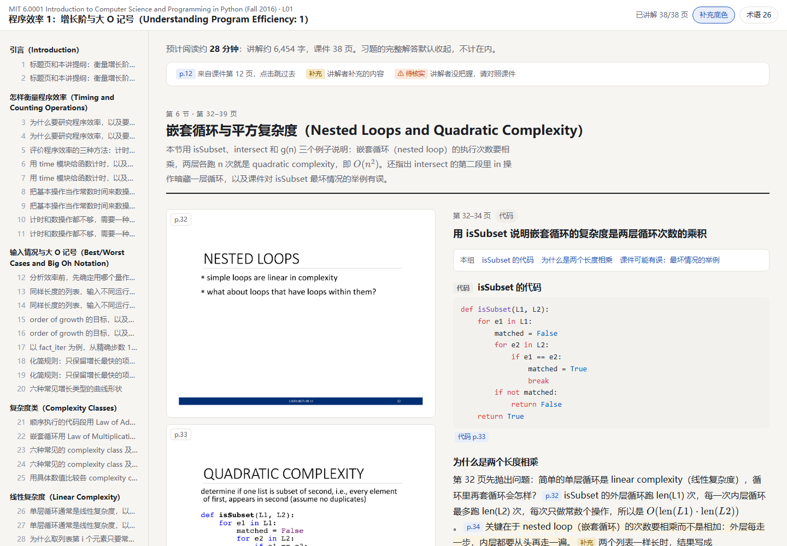

# slide-tutor

[English](README.md) | **中文**

一个 [Claude Code](https://claude.com/claude-code) skill：把课程课件 PDF 变成**左边课件原页、右边讲解**的 HTML 学习笔记，每句话都标明来源。

> 讲解用**中文**写，专业术语保留英文。

## 生成的页面是什么样

每一讲生成一个 HTML 页面：左边是目录，右边每页课件旁边是对应的讲解。



<sub>示例用的是 MIT OpenCourseWare 6.0001 第 10 讲（授权 CC BY-NC-SA 4.0）。想看完整页面，下载 [lecture10.html](examples/mit-6.0001-lec10/lecture10.html) 后用浏览器打开。出处和授权说明见 [examples/](examples/mit-6.0001-lec10/LICENSE.md)。</sub>

- **只讲重点**：每页或每组相邻页讲 1–3 个要点。会补上课件跳过的推导，解释图表、公式和代码。例子页、续页和前一页合在一起讲。
- **每句话都标来源**：
  - `[课件 p.N]` 表示课件第 N 页上有，点一下就跳到那一页。
  - `[补充]` 表示是讲解补充的内容。
  - 模型拿不准的地方标"待核实"。
- **交互式习题**：先给题目分析，再一条一条给提示，完整解答默认隐藏，点了才显示。印着答案的课件页会先遮住。
- **方便阅读**：
  - 可跳转的目录和术语表
  - 补充内容的底色开关
  - 浅色/深色主题
  - 开头写着预计阅读时间
- **可以在手机上看**：能导出成单个 HTML 文件，课件图都嵌在里面。

## 快速开始

### 1. 准备环境

- Claude Code（终端、桌面版或 IDE 插件都可以）
- Python 3.10 或更高版本。用 `python --version` 检查；Windows 上也可以用 `py -3 --version`。

其他依赖不用手动装。第一次使用时，skill 会把 PyMuPDF、Jinja2、jsonschema 自动装进单独的环境 `~/.lecture-explainer/venv`，不会动系统里的 Python。这一步大约 1 分钟，只需要一次。

### 2. 安装 skill

macOS / Linux：

```bash
git clone https://github.com/Simonwan03/slide-tutor.git
mkdir -p ~/.claude/skills
cp -r slide-tutor/lecture-explainer ~/.claude/skills/
```

Windows（PowerShell）：

```powershell
git clone https://github.com/Simonwan03/slide-tutor.git
New-Item -ItemType Directory -Force "$HOME\.claude\skills" | Out-Null
Copy-Item -Recurse slide-tutor\lecture-explainer "$HOME\.claude\skills\"
```

检查是否装好：在 Claude Code 里输入 `/lecture`，列表里应该出现 `/lecture-explainer`。没出现就重启一下 Claude Code。

> 只想在某个项目里用：把文件夹复制到 `<你的项目>/.claude/skills/` 下。

### 3. 把课件放进一个文件夹

同一门课的 PDF 放在一个文件夹里。`lectures/` 子文件夹可有可无：

```
my-course/
└── lectures/
    ├── Lec-Overview.pdf
    ├── Lec-SQL.pdf
    └── ...
```

### 4. 运行

在 `my-course/` 所在的文件夹打开 Claude Code，输入：

```
/lecture-explainer my-course SQL
```

- **第一个参数**：课程文件夹，也可以是单个 PDF。
- **第二个参数**：要讲哪一讲。可以写编号（`L04`）、文件名的一部分或主题（`SQL`）。不写的话 Claude 会问你。

之后 skill 会自己完成下面几步，不需要你插手：

1. 给 PDF 排好讲次顺序（L01、L02……），写进 `my-course/course.json`
2. 提取每页课件的图片和文字
3. 把这一讲切成若干节
4. 并行讲解各节，同时最多 4 个 subagent
5. 检查讲解，然后生成页面

一讲 50–90 页大约需要 15–40 分钟。

### 5. 打开结果

```
my-course/
├── course.json            # 讲次顺序（自动生成）
└── output/
    └── L04/
        ├── index.html     # ← 用浏览器打开这个
        ├── img/           # 课件图片
        └── work/          # 中间文件
```

页面要联网才能正常显示，因为公式和代码高亮（KaTeX、highlight.js）是从网上加载的。

## 常见问题

**为什么 Claude 不会自动调用这个 skill？**
这是故意设计的。跑一次就是讲完一整讲，大约要用 100 万 token。为了避免随口问一个课件上的问题就启动整套流程，这个 skill 设成了只能手动调用：必须输入 `/lecture-explainer` 才会启动。

**中途中断了，要从头再来吗？**
不用。在同一个对话里说"继续"就行；在新对话里，再运行一次同样的命令。已经讲完的节不会重做。

**怎么在手机上看？**
在同一个对话里说"我想在手机上看"。会在 `index.html` 旁边生成 `L04-standalone.html`。这是单个文件，图片都嵌在里面，直接发到手机上就能打开。

**某一节讲得不好，能只重讲这一节吗？**
能。删掉 `output/L04/work/sections/<节>.json`，再运行一次命令，只会重写这一节。

**讲次顺序排错了怎么办？**
在生成任何一讲之前，直接改 `course.json` 里的顺序。

**支持哪些 PDF？**
主要在 PowerPoint 导出的 PDF 上测试过。Beamer 导出的应该也能用。扫描版 PDF 还没有专门适配。

## 局限

- 讲解由模型生成，可能出错。看来源标签和"待核实"标记，就知道哪些内容要对照课件核实。
- 讲解目前只有中文。

## 版权说明

代码使用 MIT 许可证。`examples/` 里的示例由开放授权的课件生成，沿用课件的授权 CC BY-NC-SA 4.0。请只对你有权使用的课件运行这个 skill。由别人的课件生成的页面里有每一页课件的截图，请不要公开发布。

## 开发

```bash
python -m venv .venv
.venv/Scripts/pip install -r requirements-dev.txt   # macOS/Linux: .venv/bin/pip
.venv/Scripts/python -m pytest                       # macOS/Linux: .venv/bin/python
```

测试只用代码生成的 PDF。

分工是这样的：
- **模型**：看懂课件、把一讲切成若干节、写讲解。
- **Python 脚本**：提取、校验、渲染。

每份讲解都要先通过 JSON Schema 和下面这些检查，才会被渲染成页面：
- 每一页都讲到了
- 每句话都有来源
- 公式语法正确
- 提示没有泄露答案

```
lecture-explainer/
├── SKILL.md              # 给 Claude 的流程说明
├── scripts/
│   ├── lx.py             # 统一入口：init / extract / prepare / validate / render / setup
│   ├── bootstrap.py      # 自动建虚拟环境、装依赖
│   ├── extract.py        # PDF → 每页图片和文字
│   ├── prepare.py        # 检查切节，生成每个讲解单元的输入包
│   ├── validate.py       # 检查讲解 JSON
│   ├── render.py         # 讲解 JSON → HTML
│   └── schema/           # JSON Schema
├── references/           # 切节指南、讲解指南、JSON 格式说明
└── assets/template.html  # 页面模板
```

[PLAN.md](PLAN.md) 是完整的设计文档和开发记录。

## 许可证

[MIT](LICENSE)
